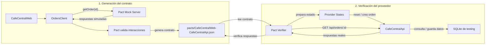

# Café Central

Aplicación sencilla de pedidos para cafetería. El frontend usa React, Vite y TypeScript; la API usa Node.js, Express y TypeScript; SQLite guarda productos, órdenes y detalles mediante `better-sqlite3`. El workspace se administra con pnpm.

## Requisitos

- Node.js 20 o superior
- pnpm 9 o superior

## Instalar y ejecutar

Desde la raíz del repositorio:

```bash
pnpm install:all
pnpm dev
```

Abre [http://localhost:5173](http://localhost:5173). Vite reenvía `/api` a la API en `http://localhost:3000`. La base se crea automáticamente en `data/cafe-central.sqlite`.

Para compilar ambos proyectos:

```bash
pnpm build
```

Para ejecutar solo la API ya compilada: `pnpm start`.

## API

- `GET /api/products`: catálogo y existencias actuales.
- `POST /api/orders`: acepta `{ "items": [{ "productId": 1, "quantity": 2 }] }`. Valida cantidades y stock, guarda orden y detalles en una transacción, descuenta existencias y devuelve `{ "id": 1, "total": 30 }`.
- `GET /api/orders/:id`: devuelve la orden persistida con sus detalles.
- `GET /api/health`: estado básico de la API.
- `POST /api/test/reset`: restaura catálogo, existencias y órdenes en una transacción. La ruta solo se registra cuando `NODE_ENV=testing`.

## Entornos

`.env.example`, `.env.testing.example` y `.env.ci.example` documentan valores de desarrollo, testing local y CI futuro; no se cargan automáticamente y no incluyen secretos. Para habilitar el reset local, configura `NODE_ENV=testing` y `DATABASE_PATH=./data/cafe-central-testing.sqlite` antes de iniciar la API. En producción usa `NODE_ENV=production`; el endpoint de reset no estará disponible. Los archivos de base de datos están excluidos de Git.

La suite E2E actual contiene una prueba smoke y tres recorridos de pedidos descritos abajo.

## Cypress E2E

Instala las dependencias con `pnpm install:all`. Para iniciar el frontend y la API con `NODE_ENV=testing` (incluido el endpoint `POST /api/test/reset`), ejecuta desde la raiz:

```bash
pnpm dev:test
```

Con ambos servidores activos, abre el runner interactivo con `pnpm cy:open` o ejecuta las pruebas en modo headless con `pnpm cy:run`.

La suite incluye el smoke del catalogo y tres recorridos de pedidos: confirmacion exitosa con verificacion de persistencia por API, carrito vacio sin POST y fallo HTTP 500 con conservacion del carrito y reintento exitoso. Cada prueba restablece productos, stock y ordenes con `POST /api/test/reset` en `beforeEach()`. El fallo controlado se simula con `cy.intercept()` y las pruebas no usan esperas numericas.

## Contract Testing con Pact

El consumidor `CafeCentralWeb` protege la capacidad de consultar una orden por ID del proveedor `CafeCentralApi`. El contrato cubre una orden existente (`200`, con total y detalles de productos) y una orden inexistente (`404`, con el error utilizado por la API). El cliente reutilizable `apps/web/src/api/ordersClient.ts` interpreta el `404` como `null`.



El contrato se genera desde las pruebas del consumidor. Después se verifica contra la implementación real del proveedor. Los Provider States preparan datos reproducibles e independientes.

Pact JS 17 requiere Node.js 22 o superior para ejecutar esta suite.

Genera y ejecuta las pruebas del consumidor con:

```bash
pnpm pact:consumer
```

Pact genera el contrato en `pacts/CafeCentralWeb-CafeCentralApi.json`. Esta etapa cubre solo el contrato del consumidor; la verificacion del proveedor corresponde a un sprint posterior. **Actualización:** Sprint 2 ya completó esa verificación; el flujo consumidor y proveedor se explica en [Pact: sprints 1 y 2](#pact-sprints-1-y-2).

## Integracion continua

El workflow de GitHub Actions se ejecuta en cada `push`, `pull_request` y cuando se inicia manualmente. Instala con pnpm usando el lockfile, compila con `pnpm build`, inicia frontend y API con `pnpm dev:test` (API en modo `testing`), espera a que respondan el frontend y la API y ejecuta Cypress. Si el job falla, guarda screenshots y videos de Cypress como artifacts para revisar el fallo.

## Pact: sprints 1 y 2

Los dos sprints de Pact implementan contract testing dirigido por el consumidor y verifican luego el mismo contrato contra el proveedor real:

- **Consumidor:** `CafeCentralWeb`, con el cliente reutilizable `apps/web/src/api/ordersClient.ts`.
- **Proveedor:** `CafeCentralApi`, la API Express de Café Central.
- **Capacidad:** consultar una orden persistida por ID mediante `GET /api/orders/:id`.
- **Interacciones del contrato:** `an order with id 1 exists` espera HTTP 200 con `id`, `total` numérico y detalles básicos; `an order with id 999 does not exist` espera HTTP 404 con el error real de la API. El cliente del consumidor convierte el 404 en `null`.
- **Contrato generado:** `pacts/CafeCentralWeb-CafeCentralApi.json` (Pact Specification V4). Lo genera Pact al ejecutar las pruebas del consumidor.
- **Herramientas instaladas:** `@pact-foundation/pact` 17.1.4 y Vitest 5.0.5. Pact JS 17 necesita Node.js 22 o superior.

Instala las dependencias desde la raíz con `pnpm install:all`. Los comandos de Pact son:

```bash
pnpm pact:consumer  # ejecuta las interacciones del consumidor y genera el contrato
pnpm pact:provider  # compila la API y verifica el contrato contra el proveedor real
pnpm pact:test      # ejecuta consumidor y luego proveedor
```

La verificación inicia automáticamente la API compilada con `NODE_ENV=testing`, `DATABASE_PATH=./data/cafe-central-pact.sqlite` y `PORT=3001`. El proceso de prueba espera su endpoint de salud, falla si el puerto 3001 ya está ocupado y lo detiene al finalizar. No se necesita iniciar otra terminal. La base de datos de Pact permanece en `data/` y está excluida de Git.

Los provider states se preparan de forma independiente a través de la API real. `an order with id 1 exists` restablece la base y crea dos cafés americanos por Q30, comprobando que el ID creado sea 1. `an order with id 999 does not exist` vuelve a restablecer la base y comprueba el 404 antes de la interacción. El orden de ejecución no afecta los datos.

**Dependencias reales verificadas:** rutas Express, lectura y escritura SQLite, y serialización HTTP de la API compilada. **Aspectos controlados por la prueba:** contenido de la base de testing, preparación de estados mediante reset y creación de una orden, puerto 3001 y configuración del proceso. La API no se sustituye por stubs.

### Cómo reproducir una incompatibilidad

Para comprobar que el contrato detecta una ruptura del tipo de `total`, edita temporalmente la respuesta exitosa en `apps/api/src/index.ts`, dentro de `GET /api/orders/:id`. Cambia:

```ts
return res.json({ ...order, items });
```

por:

```ts
return res.json({ ...order, total: String(order.total), items });
```

Luego ejecuta `pnpm pact:provider`. El comando reconstruye la API con el cambio y debe fallar porque el contrato requiere que `total` sea un número. Restaura la línea original y ejecuta `pnpm pact:provider` para comprobar la compatibilidad nuevamente, o `pnpm pact:test` para volver a ejecutar consumidor y proveedor.

La versión entregada conserva `total` como número y debe pasar ambas verificaciones. Una vez revisada la entrega, el usuario puede marcarla y publicarla con `git tag pact-final` y `git push origin pact-final`; esos comandos no se ejecutan automáticamente.
